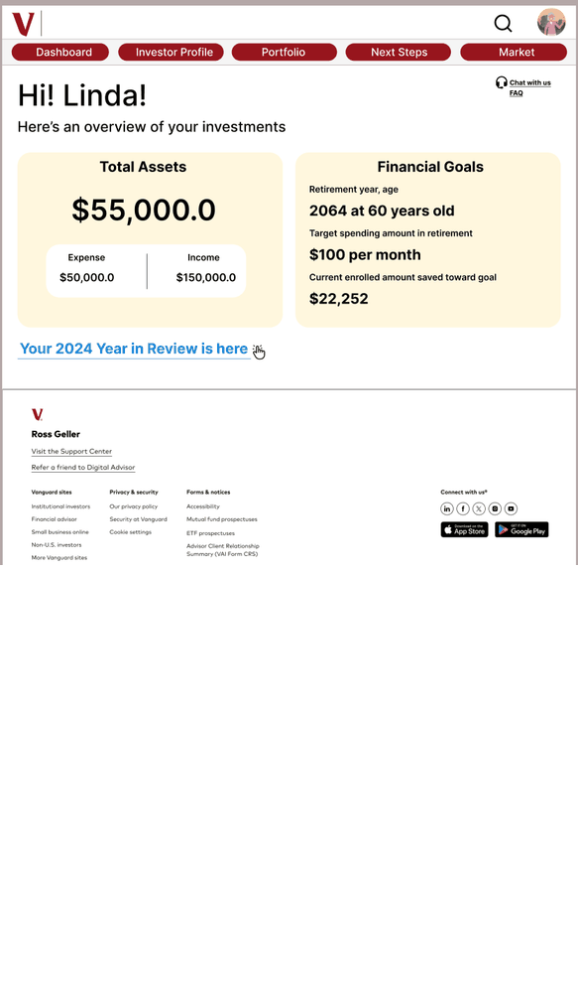

# Vanguard 年度回顾体验重设计

**面向 50 岁以上用户的个人 UI/UX 项目。**

[体验交互原型 ↗](https://www.figma.com/proto/9aaer5345gz1mAnhwSzFWj/Vanguard-YiR-redesign?page-id=0%3A1&node-id=2-35&scaling=scale-down&content-scaling=fixed) · [English](README.md) · [完整案例（英文）](docs/CASE_STUDY.md)

*原始设计界面轮播。点击预览，可进入真实 Figma 交互原型。*

这个项目重新思考 Vanguard 的年度财务回顾体验：如何让 50 岁以上用户更容易阅读数据、理解术语，并找到下一步操作。我以清晰的阅读顺序、持续可见的导航、解释性内容和更温和的视觉语言组织整个体验。

| 项目信息 | 内容 |
| --- | --- |
| 设计者 | Chloe Jian |
| 项目性质 | 个人课程重设计，UNC–Chapel Hill，MEJO 581 |
| 项目时间 | 2025 年 |
| 我的工作 | 主持远程可用性测试、研究归纳、受众分析、信息架构、线框图、视觉设计与 Figma 原型 |
| 交付成果 | 研究总结、用户画像与同理心分析、界面资产分组、结构图、线框图、UI 风格指南、高保真界面、交互原型 |
| 工具 | Figma、FigJam、Canva、Google Sheets、Zoom |
| 当前阶段 | 设计与交互原型 |

## 设计问题

一份财务报告即使看起来清楚，也可能没有回答用户真正关心的问题：这个词是什么意思？结果为什么变化？我接下来该做什么？如何回到首页或寻求帮助？

本项目将“理解信息”和“掌握操作方向”作为设计重点，在保留熟悉的金融产品视觉语言的同时，让解释、导航和下一步操作更容易被找到。

## 主要设计方向

- **明确的回顾路径。** 通过持续导航、退出入口、进度提示和前后翻页，让用户知道自己在哪里。
- **数字旁边有解释。** 增加解释性文案、术语解释入口与 Market 页面，帮助用户理解信息背景。
- **清楚的视觉层级。** 以更突出的按钮、纵向阅读顺序和温暖插画组织内容。
- **看完之后有下一步。** 将行动清单、帮助提示和常见问题连接到年度回顾中。

这些是设计回应，不代表已经测量并证明了信任提升、焦虑下降或财务效果改善。现有测试针对较早的体验，未提供最终重设计版本的对比验证结果。

## 项目文档

| 文件 | 内容 |
| --- | --- |
| [完整案例](docs/CASE_STUDY.md) | 问题、职责、过程、设计决策和反思 |
| [研究总结](docs/RESEARCH.md) | 匿名化主题、研究方式和限制 |
| [信息架构](docs/INFORMATION_ARCHITECTURE.md) | 界面资产分组与用户流程 |
| [设计决策](docs/DESIGN_DECISIONS.md) | 研究依据如何转化为具体设计 |
| [UI 风格指南](docs/DESIGN_SYSTEM.md) | 色彩、字体、组件与可访问性设计意图 |
| [原型和界面展示](docs/PROTOTYPE.md) | Figma 入口、原始界面图与查看说明 |
| [作品集文案](docs/PORTFOLIO_COPY.md) | 中英文项目卡片和详情页文案 |
| [资料依据](docs/SOURCES.md) | 已核验材料与成果边界 |
| [致谢与署名](CREDITS.md) | 作者、课程背景和素材归属 |

## 最终交付

项目形成了从研究归纳、结构图和线框图，到 UI 风格指南、高保真界面和可访问 Figma 原型的完整设计链路。整理过程中已实际打开年度回顾、Market 与 FAQ 的跳转。

这个仓库保存设计文档和视觉成果，直接阅读 Markdown 或点击原型即可，无需安装软件。原始界面图保持原比例，没有附加设备外部黑边。

原型中的姓名、金额、图表和概率数字属于示意性设计内容，不是可用性测试结果或经过验证的财务预测。参与者身份、录屏和原始研究记录未放入仓库。
