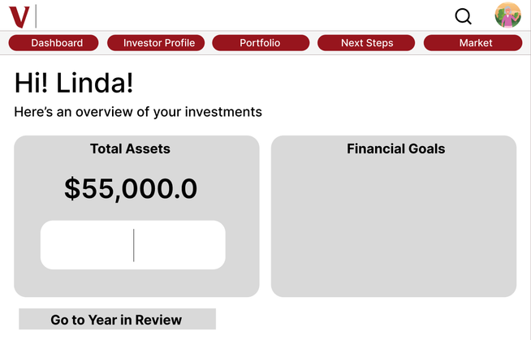

# Designing an understandable Year in Review

[Overview](../README.md) · [Prototype](PROTOTYPE.md) · [Research summary](RESEARCH.md)

## Context

Vanguard's Year in Review presents financial information that can matter deeply to someone preparing for or living in retirement. Understanding that information involves more than reading a balance: people need context for changes, explanations of terminology, and a clear way to find help or decide what to explore next.

For this personal academic project, I redesigned the experience for adults aged 50 and over. My aim was to make the interface feel understandable and supportive while retaining the familiar structure of a financial product.

The project was developed in the context of MEJO 581 at UNC–Chapel Hill. It is a design and prototype study, with illustrative account content, rather than a production financial application.

## My contribution

My work covered a remote moderated usability session, research synthesis, audience framing, persona and empathy analysis, interface-asset grouping, information architecture, wireframes, visual design, and a high-fidelity Figma prototype.

The course also included shared research work. My individual report describes facilitating my own session and contributing to the group's concluding recommendations. This case study distinguishes that shared research context from my personal redesign.

## Understanding the earlier experience

The documented session combined discussion of the participant's needs with a walkthrough of the earlier Year in Review experience. Technical difficulties required an assisted setup: I shared the interface and followed the participant's verbal directions. This allowed useful discussion, but it was not equivalent to observing independent navigation on the participant's own screen.

The materials point to a distinction between visual clarity and understanding. A clean overview could still leave the meaning of a term, the reason for a result, or the next action unclear. Anonymous themes included terminology, context for performance, consistent information, visible interactivity, and access to support.

These observations informed design priorities. They do not establish that all adults over 50 share the same financial knowledge, goals, or technical abilities. The audience profile was a design lens, not a statistically representative description.

## Framing the redesign

The central question became:

**How can the annual review help people understand what they are seeing and choose where to go next?**

I developed the experience around a guided reading sequence, with persistent ways to leave the review, return to the dashboard, and access contextual material. The design also needed to make learning content available without turning every screen into a dense explanation.

## Information before decoration

The asset inventory and grouping work separated navigation, the account snapshot, retirement progress, guidance, and action planning. A structure diagram then connected overview, portfolio information, performance, market context, suggestions, a checklist, and advisor contact.

This was an interface-analysis and organization exercise. The supplied materials do not establish a participant card-sorting study with measured agreement or a validated category model.

The diagram explored both a main route and optional paths. The later prototype uses its own screen order and a persistent navigation bar, so the early structure should be read as a planning artifact rather than an exact map of every final hotspot.

## Wireframes

At the wireframe stage, I emphasized three decisions documented in the portfolio:

- Keep navigation available across screens so the review does not feel like a dead end.
- Increase the prominence of interactive controls.
- Use a predominantly vertical reading sequence for content that does not require a side-by-side comparison.

*Original dashboard wireframe from the project portfolio.*

The wireframe set also covers review content, contributions, next steps, an action checklist, the investor profile, market information, and FAQ. This gave the later visual work an explicit information structure rather than treating each screen as an isolated composition.

## High-fidelity design

### Explain the review's context

The design keeps the original account image and financial information within a familiar dashboard structure. Inside the review, explanatory copy accompanies status information rather than presenting the status alone. Market content gives users another place to explore the broader context behind a result.

*Illustrative prototype screen. The probability value is design content, not a validated forecast or a usability metric.*

### Make movement explicit

The final design uses a persistent navigation bar, Exit, progress dots, Back, and Continue. Help cues and FAQ access remain visible in the inspected screens. The prototype's review entry, Market navigation, and FAQ navigation were directly opened during this case-study review.

The aim is to reduce uncertainty about location and available actions. No task-time reduction or navigation-success improvement is claimed without a comparative test.

### Give explanations a place

The portfolio proposes a financial glossary and clearer explanations. The visual design includes explanatory links and a dedicated FAQ area, alongside account context and market information. These mechanisms address an information need identified during research without assuming that investing experience removes the need for definitions.

The case study does not claim that every term is defined or that every help control connects to a working service. The prototype is the design deliverable.

### Use a supportive visual tone

The UI style guide combines Vanguard-related red tones with pale surfaces, supporting colors, and warm illustrations. Inter provides the main typographic family in the guide, with additional display faces for selected elements.

The design intention is a readable hierarchy and a less impersonal tone. Illustrations and reassuring language are not evidence that anxiety or trust changed. A production version would also need neutral risk wording, consistent sample data, and tested contrast and interaction behavior.

## What was delivered

The project includes research synthesis, audience and empathy work, an asset inventory, grouped interface elements, a structure diagram, eight wireframe images, a UI style guide, high-fidelity screens, and an interactive Figma prototype.

The GitHub preview is an animated sequence of the original mockups. Clicking it opens the actual prototype. No recording of a participant, synthetic redesign screen, or reconstructed interaction is used in that preview.

## Reflection and next evaluation

The strongest lesson is that legibility, explanation, and navigation need to work together. A readable chart does not answer why a result changed; a useful explanation does not help if users cannot find it; and a reassuring tone does not replace accurate, consistent information.

A next evaluation should use realistic, consistent scenario data and observe participants controlling the redesigned interface themselves. It should check whether people can explain the status information, find a definition, move out of the review, and distinguish a summary from an action affecting their account. Keyboard behavior, focus, contrast, and target sizes also need verification.

Those are proposed validation steps. The supplied materials document the earlier testing and the redesign artifacts, but do not provide a comparative usability study of the final design or evidence of a production launch.
