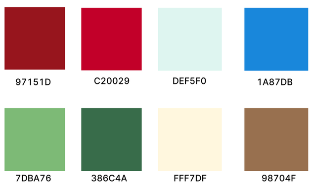
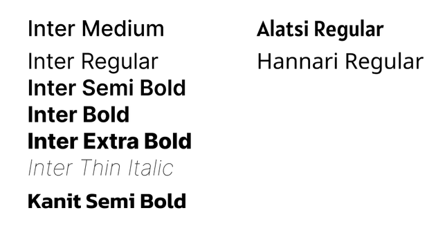
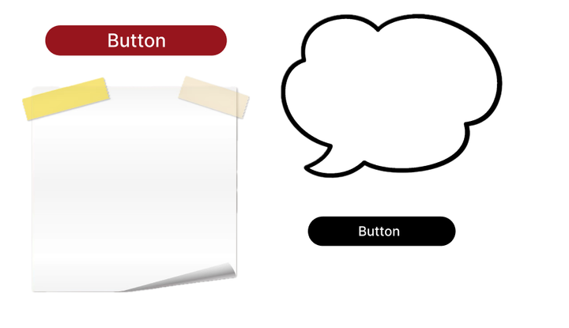

# UI style guide

[Prototype gallery](PROTOTYPE.md) · [Case study](CASE_STUDY.md)

The original guide defines a visual direction for the redesign. It is not presented as a production component library or a complete accessibility specification.

## Palette

The documented colors are `#97151D`, `#C20029`, `#DEF5F0`, `#1A87DB`, `#7DBA76`, `#386C4A`, `#FFF7DF`, and `#98704F`.

The guide connects the palette to the familiar Vanguard visual language and the illustrations used in the interface. It does not assign a tested accessible foreground/background pairing to every color. The original palette is retained rather than relabeled as a new formal token system.

## Typography

Inter appears in several weights, with supporting display faces including Kanit. The stated priorities are clarity, hierarchy, and larger readable text. Actual rendered sizes, text scaling, line length, and contrast still require verification in a production interface.

## Components and visual language

The interface uses pill-shaped navigation and buttons, pale information areas, note-card treatments, speech bubbles, charts, and warm illustrations. Progress dots and Back/Continue controls support the review sequence. The original assets are included for reference; not every interactive state is specified in the guide.

## Accessibility intentions and further validation

| Intention in the design | What needs checking |
| --- | --- |
| More prominent text and controls | Actual sizes, zoom behavior, touch targets, and content reflow |
| Clear navigation and progress | Keyboard access, focus order, accessible names, and current-location announcements |
| Text explanations for visual data | Meaning without color alone, chart descriptions, and consistent labels |
| A more predictable reading flow | Whether the sequence supports different needs and optional detail |
| Visible help and terminology support | Discoverability and understanding in independent use |

These are design intentions and evaluation tasks. No WCAG conformance or completed accessibility audit is claimed. The inspected Figma viewer reported screen-reader support disabled; that viewer setting is not an accessibility assessment of a future implemented product.
