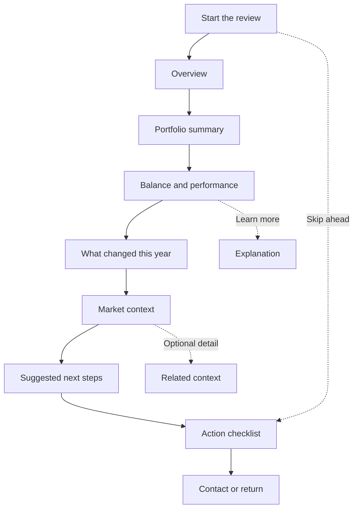
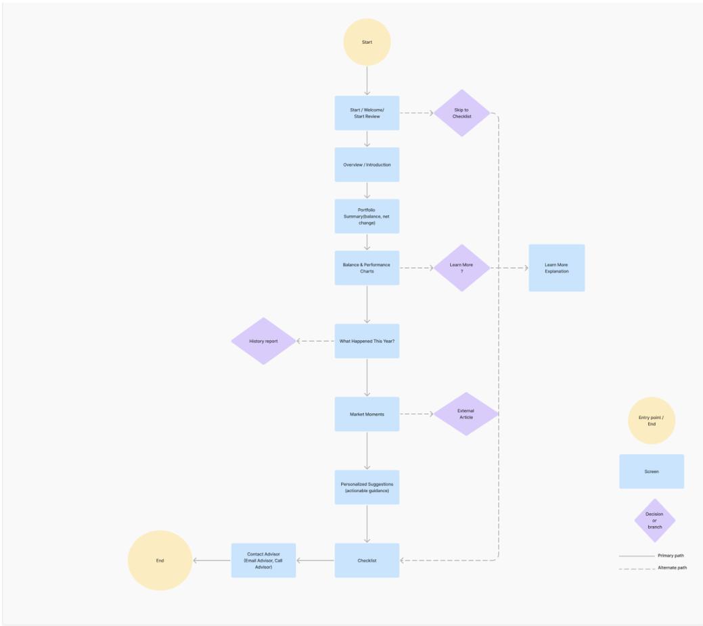

# Information architecture

[Case study](CASE_STUDY.md) · [Original FigJam structure diagram](https://www.figma.com/board/Om9BL0OTTcv0BnvftmurAe/Flows?node-id=0-1)

## Asset grouping

The portfolio organizes interface material into five conceptual groups:

| Group | Examples |
| --- | --- |
| Global navigation and controls | Product header, navigation, search, support, messages, documents, profile, exit |
| Account overview and snapshot | Asset values, contributions, funding summary, explanatory tooltips, update indicator |
| Goals and retirement progress | Goal status, year or age, projected spending, chart ranges, funding indicators |
| Guidance and explanation | Supporting copy, definitions, learn-more links, FAQ, explanatory illustrations |
| Action planning | Recommended tasks, contribution review, next steps, task states |

The linked screen-by-screen inventory describes assets, their types, and their intended purpose. It is a planning and analysis artifact, not evidence that every listed item became a working feature.

## Planned journey

This is a readable summary of the original structure diagram. It is not a verified map of every final prototype transition.

## Final prototype navigation

The inspected high-fidelity screens include Dashboard, Investor Profile, Portfolio, Next Steps, and Market in the persistent navigation. The review screens additionally show Exit, progress indicators, and Back/Continue controls. FAQ and help cues provide contextual routes.

The planning diagram, asset inventory, and later prototype differ in screen labels and order. They are retained as stages in the process, rather than made to look identical after the fact.

## Card-sort scope

The portfolio's card-sort material documents grouping UI assets and learning interface patterns. It does not establish a recruited-user card-sorting study, sorting agreement score, or statistically validated navigation model.
