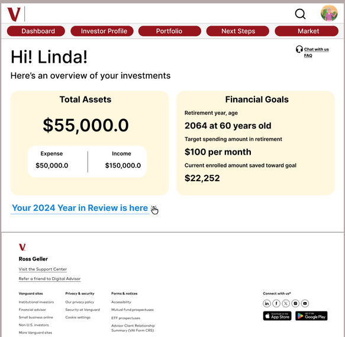
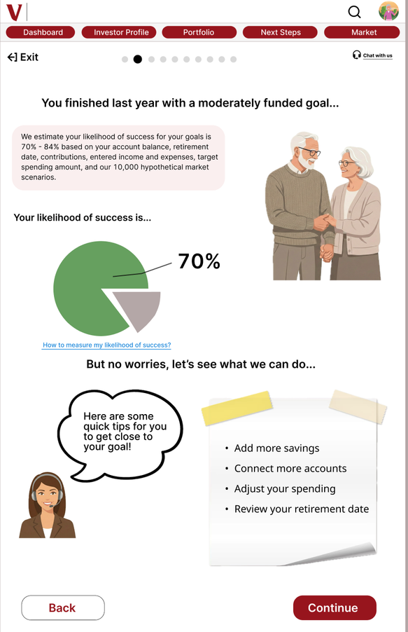
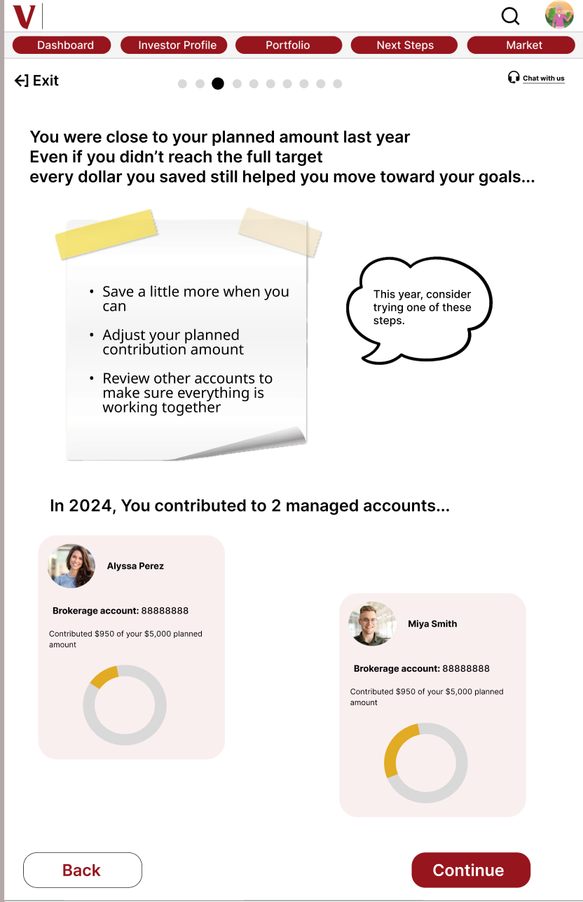
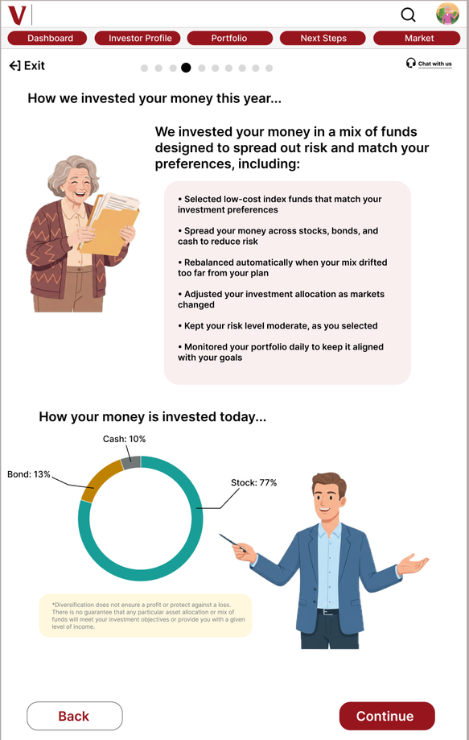
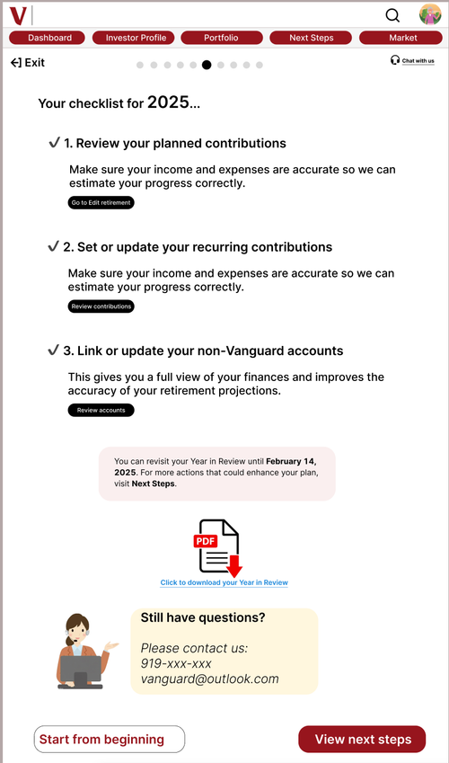
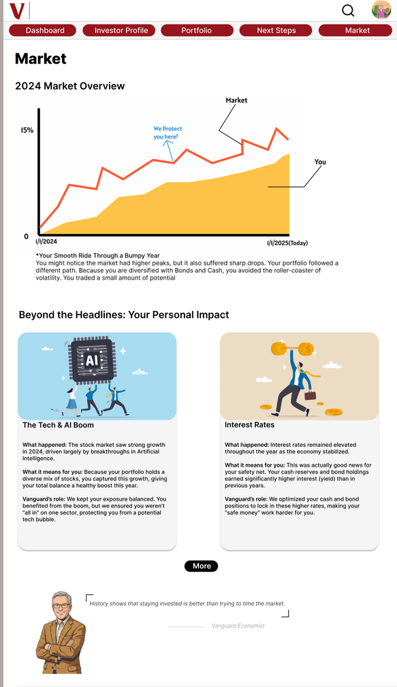

# Prototype and screen gallery

[Open the interactive prototype ↗](https://www.figma.com/proto/9aaer5345gz1mAnhwSzFWj/Vanguard-YiR-redesign?page-id=0%3A1&node-id=2-35&scaling=scale-down&content-scaling=fixed)

## Design files

| Material | Link |
| --- | --- |
| High-fidelity design file | [View in Figma](https://www.figma.com/design/9aaer5345gz1mAnhwSzFWj/Vanguard-YiR-redesign?node-id=0-1) |
| Wireframe page | [View in Figma](https://www.figma.com/design/9aaer5345gz1mAnhwSzFWj/Vanguard-YiR-redesign?node-id=72-84) |
| Structure diagram | [View in FigJam](https://www.figma.com/board/Om9BL0OTTcv0BnvftmurAe/Flows?node-id=0-1) |

The prototype is a design simulation. Use its on-screen navigation without entering real account credentials. The primary link starts at the sample dashboard.

## Original high-fidelity screens

Click any screen to open the prototype. Images are extracted from the supplied portfolio and keep their original proportions, with no external device black borders.

| Dashboard | Funding explanation |
| --- | --- |
|  |  |

| Contributions | Annual summary |
| --- | --- |
|  |  |

| Action checklist | Market context |
| --- | --- |
|  |  |

Amounts, dates, names, charts, and percentages are illustrative prototype content. They are not participant account data, measured research results, or validated financial calculations.

## Wireframe set

The source wireframe page includes [dashboard](../assets/wireframes/dashboard.png), [review introduction](../assets/wireframes/review-intro.png), [contributions](../assets/wireframes/contributions.png), [next steps](../assets/wireframes/next-steps.png), [checklist](../assets/wireframes/action-checklist.png), [investor profile](../assets/wireframes/investor-profile.png), [market](../assets/wireframes/market.png), and [FAQ](../assets/wireframes/faq.png).

## Viewing notes

The Figma prototype loaded successfully. The login demonstration led to the dashboard, the dashboard's annual-review link opened the review, and the Market and FAQ navigation opened their target frames. This is a limited interaction check, not an exhaustive hotspot test.

The source includes glossary, support, and PDF-download concepts. This review does not verify a working advisor service, complete glossary, generated report download, or connection to any financial account.

The GIF preview cycles through six original mockups. It is not a video recording of live interactions; the linked Figma prototype provides the interactive experience.
